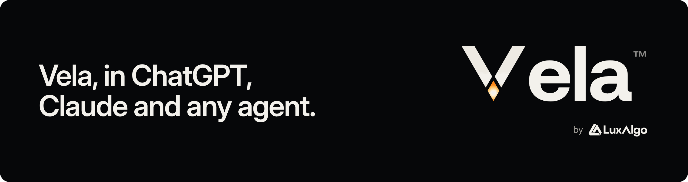
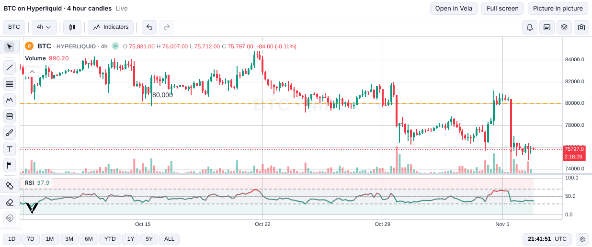
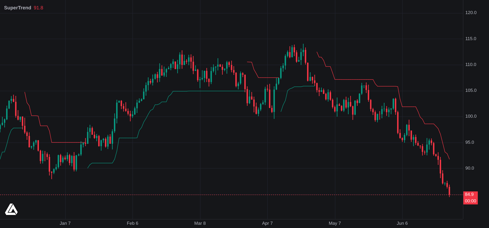

<a href="https://mcp.luxalgo.com">
  <picture>
    <source media="(prefers-color-scheme: dark)" srcset=".github/assets/cover-dark.png">
    <source media="(prefers-color-scheme: light)" srcset=".github/assets/cover-light.png">
    
  </picture>
</a>

# LuxAlgo MCP

Bring [Vela](https://vela.luxalgo.com/chart), the next-generation charting platform by LuxAlgo, into ChatGPT, Claude and any agent.

[](https://www.npmjs.com/package/@luxalgo/mcp)
[](https://registry.modelcontextprotocol.io/v0/servers?search=io.github.LuxAlgo/luxalgo-mcp-server)
[](LICENSE)

## Vela in your chat



- **Open a live chart from a sentence.** "Show BTC on 4 hour candles with RSI and a line at 80,000."
- **Change it by asking.** Market, timeframe, indicators, levels, zones, the date range. You can pan, zoom and draw on it too.
- **The model can read it.** It sees what you see: the last price, the day's change, the visible range and each indicator's value.

Run it yourself today with `LUXALGO_CHART_TOOLS=on` ([three commands](docs/self-hosting.md#live-vela-charts)). The hosted version is next.

## Add it

| Where | How |
| --- | --- |
| **ChatGPT** | LuxAlgo is an app in ChatGPT's **Plugins** directory. Search **LuxAlgo**, add it. |
| **Claude** | **Customize** > **Connectors** > **+** > **Add custom connector**: `https://claude.mcp.luxalgo.com/mcp` |
| **Claude Code** | `claude mcp add --transport http luxalgo https://mcp.luxalgo.com/mcp` |
| **Codex** | `codex mcp add luxalgo --url https://mcp.luxalgo.com/mcp` |
| **Cursor, VS Code, any client** | `https://mcp.luxalgo.com/mcp` ([Cursor](https://cursor.com/en/install-mcp?name=luxalgo&config=eyJ1cmwiOiJodHRwczovL21jcC5sdXhhbGdvLmNvbS9tY3AifQ==) · [VS Code](https://vscode.dev/redirect/mcp/install?name=luxalgo&config=%7B%22type%22%3A%22http%22%2C%22url%22%3A%22https%3A%2F%2Fmcp.luxalgo.com%2Fmcp%22%7D) one-click) |
| **Your machine** | `npx -y @luxalgo/mcp` (adds read-only broker accounts; [setup](docs/self-hosting.md#local-stdio)) |

No API key. Only the Trade Journal asks you to sign in with LuxAlgo.

## Also in the box

| What | You get |
| --- | --- |
| **The Library** | 800+ indicators and 800+ concepts from the largest indicator library in trading. Every indicator comes with an **Open in Vela** link. |
| **Session statistics** | Gap fills, opening-range breakouts, weekday effects, each with its sample size and a 95% confidence interval. |
| **Prop-firm simulations** | Your stats or real trades through a firm's exact rules, FTMO and others: the chance you pass and what it costs. |
| **Trade Journal** | Your LuxAlgo journal from the chat: performance, the P&L calendar, tags and notes. Sign-in. |
| **Broker accounts** | Read-only balances, positions and trades across 22 brokers and exchanges. Local only; keys stay on your machine. |

## Build your own Vela

The chart is Vela's open-source core: [`@luxalgo/vela`](https://www.npmjs.com/package/@luxalgo/vela), a WebGL2 charting library under Apache-2.0. Docs at [velacharts.dev](https://velacharts.dev), code at [github.com/LuxAlgo/Vela](https://github.com/LuxAlgo/Vela). Pair it with `library_get_source_code` to run any published Library indicator on your own chart.

<details>
<summary><b>A Library indicator on your own chart, in two script tags</b></summary>
<br>

<picture>
  <source media="(prefers-color-scheme: dark)" srcset=".github/assets/vela-supertrend-dark.png">
  <source media="(prefers-color-scheme: light)" srcset=".github/assets/vela-supertrend-light.png">
  
</picture>

<sub>The Library's <a href="https://www.luxalgo.com/library/indicator/supertrend/">SuperTrend</a> source as returned by <code>library_get_source_code</code>, executed by <code>@luxalgo/vela-pinets</code> on a <code>@luxalgo/vela</code> 0.6 chart in headless Chromium. The bars are a labelled synthetic sample.</sub>

`source` is the `source` field of a `library_get_source_code` result:

```html
<div id="chart" style="height: 480px"></div>
<script src="https://cdn.jsdelivr.net/npm/@luxalgo/vela@0.6.15/dist/vela.global.min.js"></script>
<script src="https://cdn.jsdelivr.net/npm/@luxalgo/vela-pinets@0.2.10/dist/vela-pinets.global.min.js"></script>
<script>
  const chart = new Vela.Vela('#chart', { data: bars, timeframe: '1D', theme: 'dark' }); // bars: [{ time, open, high, low, close, volume? }]
  chart.registerEngine('pine', new VelaPinets.PineEngine());
  chart.addIndicator(source);
</script>
```

With a bundler: `import { Vela } from '@luxalgo/vela'` and `import { PineEngine } from '@luxalgo/vela-pinets'`; see the [quickstart](https://github.com/LuxAlgo/Vela/blob/main/docs/user/quickstart.md). Pine Script® runs through [PineTS](https://github.com/LuxAlgo/PineTS), our open-source runtime (AGPL-3.0, licensed separately). Vela's attribution mark stays on unless you show equivalent attribution next to the chart; see its [NOTICE](https://github.com/LuxAlgo/Vela/blob/main/NOTICE).

</details>

## Reference

- **[Every tool](docs/tools.md)**, by area, with example asks and which address serves what.
- **[Run it yourself](docs/self-hosting.md)**: the live charts, stdio with broker keys, Docker, HTTP, environment variables, architecture.
- **[Sign-in and privacy](docs/auth.md)**: OAuth 2.1 with the LuxAlgo app. This server holds no plan checks; the app decides what your account can see, exactly as on the web.
- **[Changelog](CHANGELOG.md)** · **[Security](SECURITY.md)**

<details>
<summary><b>Contributing</b></summary>
<br>

```bash
npm install
npm run typecheck && npm run build
npm test                 # smoke suite over stdio (live endpoints); --only library,edge for a subset
npm run test:http        # the same suite against a running HTTP entry
npm run test:parity      # simulator tools against the upstream engine
npm run test:trackers    # offline checks of the Market Trackers engine
```

Adding a tool: read [AGENTS.md](AGENTS.md) and [docs/auth.md](docs/auth.md) first. Pull requests target `dev`; commits are signed off (`git commit -s`, checked by CI).

</details>

## License

Code is [MIT](LICENSE) © LuxAlgo Global, LLC. Library content and Pine Script® sources keep their own licenses; see [NOTICE](NOTICE). LuxAlgo and Vela are trademarks of LuxAlgo Global, LLC; see [TRADEMARKS.md](TRADEMARKS.md). Nothing this server returns is investment advice: simulations are modeled estimates and statistics are historical frequencies, and a prop firm's own page is authoritative for its current rules.

<div align="center">
<br>
<b>LuxAlgo, makers of Vela.</b><br>
<a href="https://www.luxalgo.com">luxalgo.com</a> · <a href="https://vela.luxalgo.com/chart">Open Vela</a> · <a href="https://github.com/LuxAlgo">GitHub</a>
</div>
