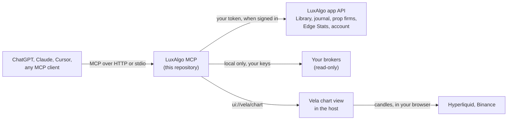

<a href="https://mcp.luxalgo.com">
  <picture>
    <source media="(prefers-color-scheme: dark)" srcset=".github/assets/cover-dark.png">
    <source media="(prefers-color-scheme: light)" srcset=".github/assets/cover-light.png">
    
  </picture>
</a>

<div align="center">

# LuxAlgo MCP

**The official MCP server from LuxAlgo, the trading technology company that built [Vela](https://vela.luxalgo.com/chart), the next-generation charting platform.**<br>
Bring the Library, prop-firm challenge simulations, session statistics and your Trade Journal into ChatGPT, Claude and any agent.

[](https://www.npmjs.com/package/@luxalgo/mcp)
[](https://registry.modelcontextprotocol.io/v0/servers?search=io.github.LuxAlgo/luxalgo-mcp-server)
[](https://github.com/LuxAlgo/luxalgo-mcp-server/actions/workflows/ci.yml)
[](LICENSE)

<a href="https://cursor.com/en/install-mcp?name=luxalgo&config=eyJ1cmwiOiJodHRwczovL21jcC5sdXhhbGdvLmNvbS9tY3AifQ=="></a>&nbsp;<a href="https://vscode.dev/redirect/mcp/install?name=luxalgo&config=%7B%22type%22%3A%22http%22%2C%22url%22%3A%22https%3A%2F%2Fmcp.luxalgo.com%2Fmcp%22%7D"></a>

[mcp.luxalgo.com](https://mcp.luxalgo.com) · [Open Vela](https://vela.luxalgo.com/chart) · [Vela on GitHub](https://github.com/LuxAlgo/Vela) · [velacharts.dev](https://velacharts.dev) · [Library](https://www.luxalgo.com/library/) · [npm](https://www.npmjs.com/package/@luxalgo/mcp) · [Changelog](CHANGELOG.md)

</div>

## What it does

| Use it for | What you get |
| --- | --- |
| **The Library** | 800+ indicators and 800+ concepts from the largest indicator library in trading: write-ups, formulas, and Pine Script® source where it is published. Indicators carry a `chart_url` that opens them on a Vela chart. |
| **Prop-firm challenges** | Monte Carlo runs of a firm's exact ruleset with your stats or your real trades: pass probability with confidence intervals, expected attempts and cost, the rule that ends most attempts. Plus the live directory of firms, challenges and their rules. |
| **Edge Stats** | Session statistics (gap fills, opening-range breakouts, weekday effects, event days) with the sample size and a 95% confidence interval on every number. |
| **Your Trade Journal** | Your LuxAlgo Trade Journal, as you: performance, the P&L calendar, breakdowns, trades and notes. Log trades, tag them and write notes from the chat. Sign in with LuxAlgo. |
| **Live Vela charts in the chat** | An interactive Vela chart rendered inside the conversation, which the model can change as you talk. In this repository today; [run it yourself](#live-vela-charts-in-your-chat). Not on the hosted address yet. |
| **Your broker accounts** | Read-only balances, positions and trades across 22 brokers and exchanges, with keys that never leave your machine. Local (npm) only. |

No API key for anything hosted. Public tools are free and read-only; the Trade Journal asks you to sign in with LuxAlgo the first time you use it.

## Add it to

### ChatGPT

LuxAlgo is an app in ChatGPT's **Plugins** directory. Open **Plugins**, search **LuxAlgo**, add it and start asking.

### Claude

**Customize** > **Connectors** > **+** > **Add custom connector**, then paste:

```
https://claude.mcp.luxalgo.com/mcp
```

Claude connects without an account; the sign-in card appears only the first time you call a journal or account tool.

### Claude Code, Codex, Cursor and any MCP client

```bash
# Claude Code
claude mcp add --transport http luxalgo https://mcp.luxalgo.com/mcp

# Codex
codex mcp add luxalgo --url https://mcp.luxalgo.com/mcp
```

Cursor (`.cursor/mcp.json`, or the button above), VS Code (the button above) and every other client take the same URL:

```json
{
  "mcpServers": {
    "luxalgo": {
      "url": "https://mcp.luxalgo.com/mcp"
    }
  }
}
```

<details>
<summary><b>Where each client keeps its config</b></summary>
<br>

| Client | Where to add it |
| --- | --- |
| Cursor | `.cursor/mcp.json`, or the install button above |
| Claude Desktop | `claude_desktop_config.json` |
| VS Code | Install button above, or MCP settings |
| Windsurf | `~/.codeium/windsurf/mcp_config.json` |
| Zed | `settings.json` under `context_servers` |
| Warp | Settings > Agents > MCP servers |
| LM Studio | `mcp.json` |
| OpenCode | `opencode.json` |
| Gemini CLI | `~/.gemini/settings.json` |

</details>

### On your own machine

```bash
npx -y @luxalgo/mcp
```

The npm package runs the same tools over stdio and adds read-only broker access. See [Local (stdio)](#local-stdio).

### Which address does what

| Address | Used by | Notes |
| --- | --- | --- |
| `https://mcp.luxalgo.com/mcp` | Any MCP client | Every hosted tool. Standard OAuth discovery. |
| `https://mcp.luxalgo.com/mcp/openai` | ChatGPT (the LuxAlgo app) | Trimmed to the plugin directory's rules: no prop-firm offers or promo codes, no political datasets. |
| `https://claude.mcp.luxalgo.com/mcp` | Claude custom connector | Same trimmed toolset. Sign-in is requested only when an account tool is called ([why](https://github.com/anthropics/claude-ai-mcp/issues/1013)). Results do not carry `chart_url` yet. |

## What you can ask

| Ask | What answers |
| --- | --- |
| "Which Library indicators measure volatility? Open the first one on a chart." | `library_search`, then the indicator's `chart_url` on Vela |
| "Explain fair value gaps, then show me the Pine Script® source of the Fair Value Gap indicator." | `library_get_concept`, `library_get_source_code` |
| "With a 45% win rate at 2R, which $50K challenge am I most likely to pass?" | `propfirms_search_challenges`, `propfirms_compare`, `propfirms_simulate` |
| "How often does Bitcoin close green on a Monday?" | `edge_report` with the `day-of-week` preset |
| "Where did I lose money last month? Tag my worst trade 'chased'." | `journal_breakdown`, `journal_list_trades`, `journal_update_trade` (sign-in) |
| "Show BTC on 4 hour candles with RSI and a line at 80,000. Now switch to ETH." | `chart_open`, `chart_command` (self-hosted, charts on) |
| "What are my open positions across Alpaca and Kraken?" | `broker_positions` (local, your own read-only keys) |

## Live Vela charts in your chat

The model opens a live, interactive Vela chart inside the conversation and keeps editing it as you talk: switch market or timeframe, add indicators, draw levels and zones, zoom to a range. You can pan, zoom and draw on it yourself, or take it to Vela with one click.


<sub>Vela inside an MCP Apps host: <code>chart_open</code> with BTC on Hyperliquid, 4 hour candles, RSI and a level at 80,000. A real capture of the chart view; the host's own interface is cropped out.</sub>

**How it works.**

1. `chart_open` returns an [MCP App](https://github.com/modelcontextprotocol/ext-apps) view (`ui://vela/chart`): one self-contained HTML document that bundles Vela's open-source core.
2. Candles stream from Hyperliquid or Binance straight into your browser. No tool result carries a price, so the model describes the chart in words and never quotes the feed.
3. `chart_command` queues edits that the view applies within seconds; the view reports back what it now shows.

**Run it yourself.** The chart tools are in this repository and off by default. They are not on the hosted address yet. Build from source and switch them on:

```bash
git clone https://github.com/LuxAlgo/luxalgo-mcp-server && cd luxalgo-mcp-server
npm install && npm run build && npm run build:chart
LUXALGO_CHART_TOOLS=on npm run start:http     # http://localhost:3333/mcp
```

Connect any host that renders MCP Apps to that URL (behind HTTPS for a remote host). Symbols are Hyperliquid perpetuals (`BTC`, `hyperliquid:ETH`) or Binance spot (`binance:BTCUSDT`); native indicators are RSI, MACD, moving average, Bollinger Bands, ATR, Stochastic, VWAP and the visible range volume profile.

### Charts in your browser, with Vela

The chart is built on **[the open-source core of Vela by LuxAlgo](https://velacharts.dev)** ([`@luxalgo/vela`](https://www.npmjs.com/package/@luxalgo/vela), Apache-2.0, [GitHub](https://github.com/LuxAlgo/Vela)): a headless chart with its own WebGL2 renderer, data providers and pluggable scripting engines. The same core is yours to build on. Pair it with the Library and you can run any published indicator on your own chart: `library_get_source_code` returns the Pine Script® source, and the [`@luxalgo/vela-pinets`](https://github.com/LuxAlgo/Vela-pinets) addon executes it.

<picture>
  <source media="(prefers-color-scheme: dark)" srcset=".github/assets/vela-supertrend-dark.png">
  <source media="(prefers-color-scheme: light)" srcset=".github/assets/vela-supertrend-light.png">
  
</picture>

<sub>The Library's <a href="https://www.luxalgo.com/library/indicator/supertrend/">SuperTrend</a> source as returned by <code>library_get_source_code</code>, executed by <code>@luxalgo/vela-pinets</code> on a <code>@luxalgo/vela</code> 0.6 chart in headless Chromium. The bars are a labelled synthetic sample.</sub>

Two script tags and three calls. `source` is the `source` field of a `library_get_source_code` result:

```html
<div id="chart" style="height: 480px"></div>
<script src="https://cdn.jsdelivr.net/npm/@luxalgo/vela@0.6.15/dist/vela.global.min.js"></script>
<script src="https://cdn.jsdelivr.net/npm/@luxalgo/vela-pinets@0.2.10/dist/vela-pinets.global.min.js"></script>
<script>
  const chart = new Vela.Vela('#chart', { data: bars, timeframe: '1D', theme: 'dark' }); // bars: [{ time, open, high, low, close, volume? }]
  chart.registerEngine('pine', new VelaPinets.PineEngine());
  chart.addIndicator(source);
</script>
```

With a bundler: `import { Vela } from '@luxalgo/vela'` and `import { PineEngine } from '@luxalgo/vela-pinets'`; see Vela's [quickstart](https://github.com/LuxAlgo/Vela/blob/main/docs/user/quickstart.md). Pine Script® runs through [PineTS](https://github.com/LuxAlgo/PineTS), our open-source runtime (AGPL-3.0, licensed separately from Vela's Apache-2.0 and this server's MIT). Vela's attribution mark stays on unless you show equivalent attribution next to the chart; see Vela's [NOTICE](https://github.com/LuxAlgo/Vela/blob/main/NOTICE).

## Tools

Names are stable; every result is compact JSON with canonical URLs for citation.

**Library** (public)

| Tool | Returns |
| --- | --- |
| `library_search` | One search over concepts (alias-aware) and indicators; indicator hits carry `chart_url` |
| `library_get_concept` | A concept page as markdown, plus its indicators, each with `chart_url` |
| `library_get_indicator` | An indicator's write-up, family, concepts, source availability and `chart_url` |
| `library_get_source_code` | Pine Script® source on demand: in full when publicly served, or the start of it (`complete: false`) where the app previews it to signed-out users |
| `library_list_concepts` | Concepts, paginated, optionally per family |
| `library_list_indicators` | Filtered, sorted, paginated indicators (family, concept, platform, tier) |
| `library_list_families` | The taxonomy with counts |
| `library_get_family` | A family hub as markdown, with its concepts |

**Prop firms** (public; the simulator runs inside the server)

| Tool | Returns |
| --- | --- |
| `propfirms_simulate` | Monte Carlo of your stats through a challenge's exact rules: pass probability with CI, killing rule, expected attempts and cost, EV, payout odds |
| `propfirms_simulate_trades` | The same from your real R-multiple trade series (block bootstrap keeps your streaks) |
| `propfirms_optimal_risk` | Pass-optimal vs EV-optimal risk per trade |
| `propfirms_compare` | One trader across up to 12 challenges, EV-sorted |
| `propfirms_pass_rates` | Reference odds per challenge, or a firm overview |
| `propfirms_validate_strategy` | One strategy screened across every simulatable challenge against a pass bar |
| `propfirms_list_simulatable` | Simulatable firms, or one firm's challenges |
| `propfirms_challenge_rules` | One challenge's encoded ruleset, editable and re-simulatable inline |
| `propfirms_search` | Firms by platform, market, payment, rating, country, with nested challenge and offer filters |
| `propfirms_get` | One firm's dossier: profile, challenges, live offers, page link |
| `propfirms_search_challenges` | Challenges by rules; natural queries such as "FTMO 2-step 100k" work |
| `propfirms_search_offers` | Current discounts and promo codes (not on the ChatGPT or Claude addresses) |

Simulations are distributions under stated assumptions, deterministic under seed, never predictions or financial advice. Engine: [prop-firm-sim](https://github.com/LuxAlgo/prop-firm-sim).

**Edge Stats** (public)

| Tool | Returns |
| --- | --- |
| `edge_symbols` | Covered symbols, session calendars, coverage windows, last build; each with `chart_url` |
| `edge_presets` | The precomputed questions, each stating what its number means |
| `edge_report` | One result with estimate, N, Wilson 95% CI, minimum-sample guards, stability split, per-year counts, distribution |

Every number arrives with its sample size. Computed nightly by the open-source [edge-stats](https://github.com/LuxAlgo/edge-stats) engine; opening-gap presets on round-the-clock markets are refused with the reason.

**Trade Journal and account** (sign-in)

| Tool | Returns |
| --- | --- |
| `journal_list_accounts` | Journal accounts and the journal timezone (the first call: every `accounts` filter takes these ids) |
| `journal_overview` | The dashboard for a window: metrics, Edge Score, daily P&L, equity curve, open positions; optional comparison window |
| `journal_calendar` | One month of the P&L calendar |
| `journal_breakdown` | Closed trades by weekday, time of day, hold time, symbol, side, size, tag, rating, asset class |
| `journal_list_trades` | Trade summaries, filtered, sorted, keyset-paginated |
| `journal_get_trade` | One trade in full: fills, per-exit P&L, annotations |
| `journal_get_day` | One day's stats, trades and notes |
| `journal_list_tags` | Your tags, mistakes and playbooks with usage counts |
| `journal_search_notes` | Day and trade notes as one searchable stream |
| `journal_add_trade` | Log a trade by hand (fills into a manual or import account) |
| `journal_update_trade` | Annotate a trade: notes, tags, mistakes, playbook, rating, stop, target, reviewed |
| `journal_write_note` / `journal_update_note` | Add a day note, or edit or move one |
| `luxalgo_account` | Your plan, entitlements and profile basics |

These act only as you, on your own data, and the app validates every change.

**Live Vela charts** (self-hosted with `LUXALGO_CHART_TOOLS=on`; not on the hosted address yet)

| Tool | Returns |
| --- | --- |
| `chart_open` | An interactive Vela chart in the chat (market, timeframe, indicators, levels, zones, range) and its `chart_id` |
| `chart_command` | Edits to the open chart, applied in place; what it now shows, in words |
| `chart_sync` | Used by the chart view only, never by the model |

**Brokers** (local stdio only)

| Tool | Returns |
| --- | --- |
| `broker_setup` | Supported brokers, their env vars (set or unset, never values), read-only key guides |
| `broker_accounts` | Connected accounts: broker, currency, equity, cash |
| `broker_positions` | Open positions with market value, asset class, entry price |
| `broker_trades` | Trade history, newest first |
| `broker_stats` | Total and per-broker equity, top positions, FIFO win rate and realized P&L |
| `broker_refresh` | Re-fetch now, past the 5-minute cache |

Read-only by construction, via [broker-sdk](https://github.com/LuxAlgo/broker-sdk): it has no trading endpoints, and per-broker failures are reported, never dropped.

<details>
<summary><b>Market Trackers</b> (public): the public record of US markets from primary sources</summary>
<br>

| Tool | Returns |
| --- | --- |
| `trackers_datasets` | Every dataset's rows, freshness and years; with `dataset`, its fields, filters, caveats and dump URLs |
| `trackers_query` | One dataset by ticker, text, field values and date range |
| `trackers_latest` | A dataset's newest daily delta |
| `trackers_ticker` | One ticker across every ticker-bearing dataset for a year |

Congressional trades, insider filings, 13F holdings, federal contracts, lobbying, short-sale volume, patents, clinical trials, FDA events, CFTC positioning and more, read from the CC0 dumps of [market-trackers](https://github.com/LuxAlgo/market-trackers) with a primary-source link on every row. Data only: no signals or scores.

</details>

## Sign-in and privacy

- **Public tools need nothing.** The Library, prop firms, Edge Stats and Market Trackers work anonymously, in every client.
- **The journal and account tools need a LuxAlgo sign-in**, over standard OAuth 2.1 with [app.luxalgo.com](https://app.luxalgo.com) as the authorization server. Hosted clients get a `401` challenge on the first account-tool call and handle the rest (discovery, PKCE, consent in your browser). Each tool declares its policy in `tools/list` (`securitySchemes`), so per-tool linking works in ChatGPT.
- **The app decides what you can see, not this server.** This code is public, so it holds no plan checks. It forwards your token, and the LuxAlgo app applies your account's rules exactly as on the web, answering `401` (sign in) or `403` (outside your plan), which the tool reports as such. A modified copy of this server can do no more than you can in the browser. Details: [docs/auth.md](docs/auth.md).
- **Broker keys stay local.** They live in your MCP client config as env vars, are read only by the stdio server on your machine, and are never sent anywhere but your broker.
- **Charts stream from the exchanges to your browser.** No price passes through this server.

## Run it yourself

### Local (stdio)

Runs every hosted tool locally and adds the broker tools. Set read-only credentials for the brokers you use; a broker connects when all of its variables are set.

```json
{
  "mcpServers": {
    "luxalgo": {
      "command": "npx",
      "args": ["-y", "@luxalgo/mcp"],
      "env": {
        "BROKERS_ALPACA_API_KEY": "...",
        "BROKERS_ALPACA_API_SECRET": "...",
        "BROKERS_KRAKEN_API_KEY": "...",
        "BROKERS_KRAKEN_API_SECRET": "...",
        "BROKERS_HYPERLIQUID_WALLET_ADDRESS": "0x..."
      }
    }
  }
}
```

Variables follow `BROKERS_<BROKER>_<FIELD>` (for example `BROKERS_OKX_PASSPHRASE`, `BROKERS_IBKR_FLEX_FLEX_TOKEN`); `broker_setup` lists every broker, its exact variables and how to create a read-only key.

Sign in once for the journal tools; the local server is its own OAuth client:

```bash
npx -y @luxalgo/mcp login     # opens your browser
npx -y @luxalgo/mcp status    # who is signed in, token expiry
npx -y @luxalgo/mcp logout
```

Tokens are stored in `~/.config/luxalgo/mcp-auth.json` (`%APPDATA%\luxalgo\mcp-auth.json` on Windows), mode 0600, refreshed automatically and sent only to the LuxAlgo app. Clients that support URL-mode elicitation can skip `login`: the first account-tool call opens the sign-in page.

### Docker

```bash
docker build -t luxalgo-mcp .
docker run -i --rm luxalgo-mcp                                       # the stdio server
docker run -i --rm -e BROKERS_ALPACA_API_KEY=... luxalgo-mcp          # with broker keys
```

### Streamable HTTP

```bash
npm install && npm run build
npm run start:http            # http://localhost:3333/mcp (PORT to change it)
```

Any Node 20+ host works. `npm run build:chart` builds the chart view for `LUXALGO_CHART_TOOLS=on`.

### Environment

| Variable | Default | Purpose |
| --- | --- | --- |
| `LUXALGO_CHART_TOOLS` | off | `on` registers the live chart tools |
| `LUXALGO_CHART_ORIGIN` | `https://vela.luxalgo.com` | Where `chart_url` and "Open in Vela" open the chart |
| `LUXALGO_CHART_APP_DOMAIN` | per host | Sandbox origin for the chart view; `none` leaves it out |
| `LUXALGO_APP_ORIGIN` | `https://app.luxalgo.com` | The LuxAlgo app: API and OAuth authorization server (`<origin>/api/auth`) |
| `LUXALGO_SITE_ORIGIN` | `https://www.luxalgo.com` | The marketing site the Library pages come from |
| `MCP_RESOURCE` | `https://mcp.luxalgo.com/mcp` | This server's resource identifier and token audience |
| `LUXALGO_AUTH_CHALLENGE` | `http` | `result` answers an anonymous protected call in-band instead of with HTTP 401 |
| `LUXALGO_MCP_AUTH_FILE` | `~/.config/luxalgo/mcp-auth.json` | Where the stdio server stores tokens |
| `PORT` | `3333` | Port of the HTTP entry |
| `MARKET_TRACKERS_DUMPS_ORIGIN`, `MARKET_TRACKERS_DATA_REPO` | the public dumps | Point Market Trackers at another dumps tree |
| `POSTHOG_PROJECT_TOKEN`, `POSTHOG_HOST` | unset | Opt-in usage analytics; off unless a token is set |
| `BROKERS_<BROKER>_<FIELD>` | unset | Read-only broker credentials (stdio) |

## Architecture at a glance



```
src/
  entries/       stdio (npx), node-http, and the hosted entry used by api/server.ts
  server/        manifest.ts (the tool modules), create-server.ts, version.ts
  tools/<domain> one directory per domain: library, propfirms, edge, journal, account,
                 broker, trackers, chart; index.ts exports a ToolModule
  auth/          OAuth: metadata, challenge, token verification, the stdio client
  platform/      app-client.ts (the one HTTP client for the LuxAlgo app), analytics
view/chart/      the chart view, bundled with Vela's open-source core into one HTML file
test/            smoke suites per domain, parity, trackers checks
```

The server holds no entitlement logic and no market data: it shapes answers from the LuxAlgo app, the open-source engines it embeds (prop-firm-sim, broker-sdk) and public data.

## Contributing

```bash
npm install
npm run typecheck && npm run build
npm test                 # smoke suite over stdio (live endpoints); --only library,edge for a subset
npm run test:http        # the same suite against a running HTTP entry
npm run test:parity      # simulator tools against the upstream engine
npm run test:trackers    # offline checks of the Market Trackers engine
```

Adding a tool: read [AGENTS.md](AGENTS.md) and [docs/auth.md](docs/auth.md) first. Pull requests target `dev`; commits are signed off (`git commit -s`, checked by CI). Security reports: [SECURITY.md](SECURITY.md).

## License

Code is [MIT](LICENSE) © LuxAlgo Global, LLC. Library content and Pine Script® sources served by this server keep their own licenses; see [NOTICE](NOTICE). LuxAlgo and Vela are trademarks of LuxAlgo Global, LLC; see [TRADEMARKS.md](TRADEMARKS.md).

Nothing this server returns is investment advice. Simulations are modeled estimates under stated assumptions, statistics are historical frequencies, and a prop firm's own page is authoritative for its current rules.

<div align="center">
<br>
<b>LuxAlgo, makers of Vela.</b><br>
<a href="https://www.luxalgo.com">luxalgo.com</a> · <a href="https://vela.luxalgo.com/chart">Open Vela</a> · <a href="https://velacharts.dev">velacharts.dev</a> · <a href="https://github.com/LuxAlgo">GitHub</a>
</div>
