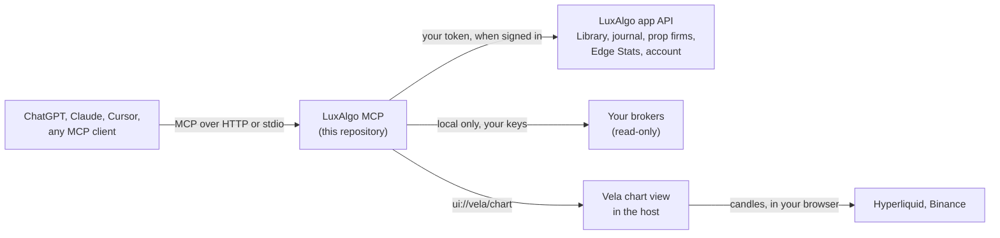

# Run it yourself

Everything the hosted server does runs on your own machine too, plus read-only broker accounts. The live Vela charts and the Vela account tools are off by default when you run it yourself; switch them on with the variables below. Back to the [README](../README.md).

## Live Vela charts

The chart tools are in this repository and off by default. Build from source and switch them on:

```bash
git clone https://github.com/LuxAlgo/luxalgo-mcp-server && cd luxalgo-mcp-server
npm install && npm run build && npm run build:chart
LUXALGO_CHART_TOOLS=on npm run start:http     # http://localhost:3333/mcp
```

Connect any host that renders [MCP Apps](https://github.com/modelcontextprotocol/ext-apps) to that URL (behind HTTPS for a remote host). Symbols are Hyperliquid perpetuals (`BTC`, `hyperliquid:ETH`) or Binance spot (`binance:BTCUSDT`); built-in indicators are RSI, MACD, moving average, Bollinger Bands, ATR, Stochastic, VWAP and the visible range volume profile.

How it works:

1. `chart_open` returns an MCP App view (`ui://vela/chart`): one self-contained HTML document that bundles Vela's open-source core.
2. Candles stream from Hyperliquid or Binance straight into your browser. No tool result carries bars; for these exchange-fed markets the model gets what you see on screen (the last price, the day's change, the visible range's high and low, each indicator's latest value).
3. `chart_command` queues edits that the view applies within seconds; the view reports back what it now shows. The view checks for edits about every second while something happens on the chart (it just loaded, applied an edit, you touched it, or the model is at work on it), about every 6 seconds when it is idle, and not at all while it is hidden or out of view; an edit made while it is idle applies at its next check, and `chart_command` says when.
4. "Open in Vela" carries the same view into Vela at [vela.luxalgo.com](https://vela.luxalgo.com/chart).

## Local (stdio)

Runs every hosted tool locally and adds the broker tools. Set read-only credentials for the brokers you use; a broker connects when all of its variables are set.

```json
{
  "mcpServers": {
    "luxalgo": {
      "command": "npx",
      "args": ["-y", "@luxalgo/mcp"],
      "env": {
        "BROKERS_ALPACA_API_KEY": "...",
        "BROKERS_ALPACA_API_SECRET": "...",
        "BROKERS_KRAKEN_API_KEY": "...",
        "BROKERS_KRAKEN_API_SECRET": "...",
        "BROKERS_HYPERLIQUID_WALLET_ADDRESS": "0x..."
      }
    }
  }
}
```

Variables follow `BROKERS_<BROKER>_<FIELD>` (for example `BROKERS_OKX_PASSPHRASE`, `BROKERS_IBKR_FLEX_FLEX_TOKEN`); `broker_setup` lists every broker, its exact variables and how to create a read-only key. Broker keys live in your MCP client config, are read only by the stdio server on your machine, and are sent nowhere but your broker.

Sign in once for the journal tools; the local server is its own OAuth client:

```bash
npx -y @luxalgo/mcp login     # opens your browser
npx -y @luxalgo/mcp status    # who is signed in, token expiry
npx -y @luxalgo/mcp logout
```

Tokens are stored in `~/.config/luxalgo/mcp-auth.json` (`%APPDATA%\luxalgo\mcp-auth.json` on Windows), mode 0600, refreshed automatically and sent only to the LuxAlgo app. Clients that support URL-mode elicitation can skip `login`: the first account-tool call opens the sign-in page.

## Where each client keeps its config

| Client | Where to add it |
| --- | --- |
| Cursor | `.cursor/mcp.json`, or [one-click install](https://cursor.com/en/install-mcp?name=luxalgo&config=eyJ1cmwiOiJodHRwczovL21jcC5sdXhhbGdvLmNvbS9tY3AifQ==) |
| Claude Desktop | `claude_desktop_config.json` |
| VS Code | [One-click install](https://vscode.dev/redirect/mcp/install?name=luxalgo&config=%7B%22type%22%3A%22http%22%2C%22url%22%3A%22https%3A%2F%2Fmcp.luxalgo.com%2Fmcp%22%7D), or MCP settings |
| Windsurf | `~/.codeium/windsurf/mcp_config.json` |
| Zed | `settings.json` under `context_servers` |
| Warp | Settings > Agents > MCP servers |
| LM Studio | `mcp.json` |
| OpenCode | `opencode.json` |
| Gemini CLI | `~/.gemini/settings.json` |

## Docker

```bash
docker build -t luxalgo-mcp .
docker run -i --rm luxalgo-mcp                                       # the stdio server
docker run -i --rm -e BROKERS_ALPACA_API_KEY=... luxalgo-mcp          # with broker keys
```

## Streamable HTTP

```bash
npm install && npm run build
npm run start:http            # http://localhost:3333/mcp (PORT to change it)
```

Any Node 20+ host works. `npm run build:chart` builds the chart view for `LUXALGO_CHART_TOOLS=on`.

## Environment

| Variable | Default | Purpose |
| --- | --- | --- |
| `LUXALGO_CHART_TOOLS` | off | `on` registers the live chart tools (never on the Claude address) |
| `LUXALGO_ACCOUNT_TOOLS` | off | `on` registers the watchlist and layout tools and `chart_peek`, and the alert tools when `LUXALGO_ALERT_TOOLS` is on too (never on the Claude address) |
| `LUXALGO_ALERT_TOOLS` | off | `on`, with `LUXALGO_ACCOUNT_TOOLS=on`, registers the alert tools (`alerts_*`); off until LuxAlgo Alerts are open to every member |
| `LUXALGO_PAPER_TOOLS` | off | `on` registers the Paper Trading by LuxAlgo tools (`paper_*`; simulated money, every order on your yes; never on the Claude address) |
| `LUXALGO_CHART_ORIGIN` | `https://vela.luxalgo.com` | Where `chart_url` and "Open in Vela" open the chart |
| `LUXALGO_CHART_APP_DOMAIN` | per host | Sandbox origin for the chart view; `none` leaves it out |
| `LUXALGO_APP_ORIGIN` | `https://app.luxalgo.com` | The LuxAlgo app: API and OAuth authorization server (`<origin>/api/auth`) |
| `LUXALGO_SITE_ORIGIN` | `https://www.luxalgo.com` | The marketing site the Library pages come from |
| `MCP_RESOURCE` | `https://mcp.luxalgo.com/mcp` | This server's resource identifier and token audience |
| `LUXALGO_AUTH_CHALLENGE` | `http` | `result` answers an anonymous protected call in-band instead of with HTTP 401 |
| `LUXALGO_MCP_AUTH_FILE` | `~/.config/luxalgo/mcp-auth.json` | Where the stdio server stores tokens |
| `PORT` | `3333` | Port of the HTTP entry |
| `MARKET_TRACKERS_DUMPS_ORIGIN`, `MARKET_TRACKERS_DATA_REPO` | the public dumps | Point Market Trackers at another dumps tree |
| `POSTHOG_PROJECT_TOKEN`, `POSTHOG_HOST` | unset | Opt-in usage analytics; off unless a token is set |
| `BROKERS_<BROKER>_<FIELD>` | unset | Read-only broker credentials (stdio) |

## Architecture



```
src/
  entries/       stdio (npx), node-http, and the hosted entry used by api/server.ts
  server/        manifest.ts (the tool modules), create-server.ts, version.ts
  tools/<domain> one directory per domain: library, propfirms, edge, journal, account,
                 broker, trackers, chart; index.ts exports a ToolModule
  auth/          OAuth: metadata, challenge, token verification, the stdio client
  platform/      app-client.ts (the one HTTP client for the LuxAlgo app), analytics
view/chart/      the chart view, bundled with Vela's open-source core into one HTML file
test/            smoke suites per domain, parity, trackers checks
```

The server holds no entitlement logic and no market data: it shapes answers from the LuxAlgo app, the open-source engines it embeds (prop-firm-sim, broker-sdk) and public data.
